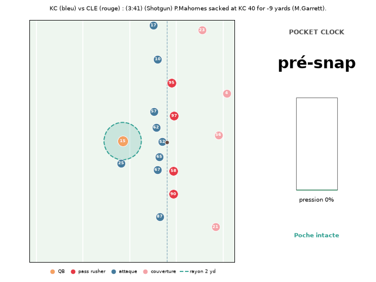
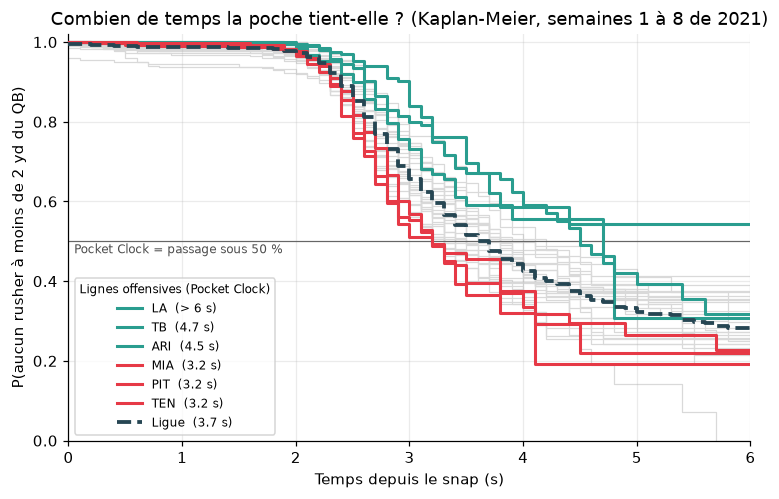
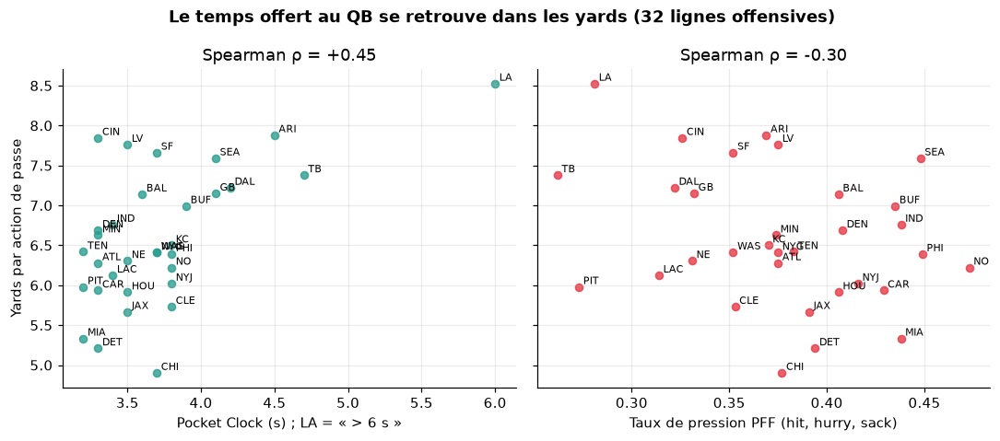
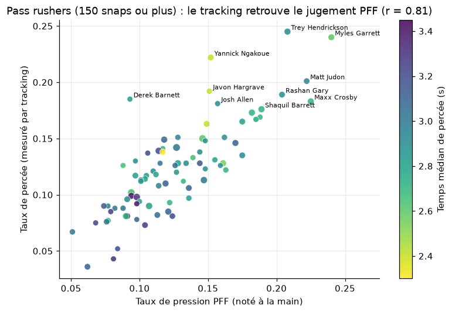

# NFL Big Data Bowl : quête du jour

> **Résumé**
> _Ce qu'on a construit :_ le **Pocket Clock**, une métrique issue du tracking qui mesure combien de temps une ligne offensive garde le QB à l'abri (aucun pass rusher à moins de 2 yd), estimée par analyse de survie pour tenir compte des passes lancées avant la percée. Elle est livrée avec un dashboard interactif, des graphiques et une animation action par action.
> _Ce que ça révèle :_ en moyenne, la poche est percée à 3,7 s, mais l'écart va de 3,2 s (MIA, PIT, TEN) à plus de 6 s (LA). Le Pocket Clock d'une attaque est mieux lié à ses yards par action (Spearman ρ = +0,45) que son taux de pression PFF noté à la main (ρ = −0,30), tout en restant cohérent avec PFF (82 % d'accord action par action).
> _Qui l'utiliserait :_ un coach de ligne offensive ou défensive (quelles équipes, quels duels, à quel moment la poche cède), un recruteur (rushers qui percent le plus vite, bloqueurs qui tiennent leur duel) et un commentateur (chrono de poche affiché en direct).



## Le défi

Construire un outil ou une visualisation de données NFL qu'un **coach**, un **recruteur** ou un **commentateur** utiliserait, sous l'une de ces deux formes :

- **Visualisation / outil de comparaison** : graphique, dashboard, animation ou outil interactif ;
- **Métrique / score** : une nouvelle statistique qui mesure quelque chose d'encore inexploré.

Évaluation (note de 1 à 5) : compréhension du football, exécution technique, communication, originalité.

## Les données

Source : [ThompsonJamesBliss/nfl-big-data-bowl-regional-event-data](https://github.com/ThompsonJamesBliss/nfl-big-data-bowl-regional-event-data) (format du Big Data Bowl 2023, NGS + PFF).

- **Périmètre** : saison 2021, semaines 1 à 8, 122 matchs, environ 8 500 actions de passe, environ 8,3 M lignes de tracking.
- **Tracking** (`tracking_[gameId].csv`) : position `x`/`y`, vitesse `s`, accélération `a`, orientation `o` et direction `dir` de chaque joueur et du ballon, à 10 images/s, du snap jusqu'à la passe ou au sack.
- **Plays** (`plays.csv`) : contexte de l'action (down, distance, formation, personnel, couverture PFF, résultat).
- **PFF Scouting** (`pffScoutingData.csv`) : rôle de chaque joueur (pass rush, pass block, coverage, route), hits, hurries et sacks, sacks concédés, adversaire bloqué, type de bloc.
- **Players / Games** : infos joueurs (poste, taille, poids) et matchs.

Clés de jointure : `gameId`, `playId`, `nflId`.

## Installation

```bash
git clone https://github.com/ThompsonJamesBliss/nfl-big-data-bowl-regional-event-data.git data_nfl   # environ 1 Go, non versionné
python3 -m venv .venv && source .venv/bin/activate
pip install -r requirements.txt
```

## La métrique : Pocket Clock

La poche est **percée** dès qu'un pass rusher entre à moins de **2 yards** du QB. Le **Pocket Clock** d'une ligne offensive, c'est le temps médian avant cette percée.

- **Censure** : quand le QB lance avant la percée, on sait seulement que la poche a tenu *au moins* jusque-là. Le temps médian est donc estimé avec Kaplan-Meier (méthode d'analyse de survie), pas avec une simple moyenne.
- **Validation contre PFF** (hit, hurry, sack, notés à la main) : 82 % d'accord action par action, et un AUC de 0,88 pour la distance minimale entre un rusher et le QB. Le rayon de 2 yd est celui qui maximise l'accord : on a testé de 1 à 3 yd.
- **Joueurs** : le taux de percée des rushers corrèle à 0,81 avec leur taux de pression PFF. Pour les bloqueurs, le duel est identifié via `pff_nflIdBlockedPlayer` et la corrélation est de 0,67.

## Résultats

**Combien de temps la poche tient-elle ?** Dans toute la ligue, 85 % des poches sont encore intactes à 2,5 s, puis elles cèdent vite : le Pocket Clock de la ligue est de 3,7 s.



- **Lignes offensives** : LA (plus de 6 s ; la poche tient dans plus de la moitié des cas jusqu'à 6 s), TB (4,7 s) et ARI (4,5 s) en tête ; MIA, PIT et TEN ferment la marche (3,2 s).
- **Pass rush** : CLE et PHI percent le plus vite (3,1 s), ATL le plus lentement (4,8 s).
- **Lien avec la production** : sur les 32 attaques, le Pocket Clock suit les yards par action (Spearman ρ = +0,45) mieux que le taux de pression PFF (ρ = −0,30). On utilise une corrélation de rangs parce que la valeur de LA est une borne inférieure (6 s).



- **Pass rushers** : Trey Hendrickson (24,5 % de percées) et Myles Garrett (24,0 %) dominent. Yannick Ngakoue (22,2 %) perce vite (2,4 s en médiane) alors que PFF ne lui attribue que 15 % de pressions ; le plus rapide est Haason Reddick (2,3 s en médiane).
- **Bloqueurs** : le meilleur est Ryan Jensen (C, TB : 3,6 % de percées concédées). 4 des 10 bloqueurs les plus fiables sont des Buccaneers (Jensen, Wirfs, Marpet, Cappa), ce qui explique leur 4,7 s.



**Limites** : semaines 1 à 8 seulement (de 203 à 338 actions par attaque) ; le rayon de 2 yd ne distingue pas un rusher qui arrive de face d'un rusher qui contourne la poche ; un QB qui sort de la poche (scramble, roll-out) la « déplace » avec lui.

## Structure du projet

```
analysis/explore.py   analyse exploratoire (stats descriptives, pression, temps de lancer)
metrics/data.py       chargement des CSV + fenêtre snap -> passe/sack de chaque action
metrics/pocket.py     calcul du Pocket Clock et génération de outputs/
outputs/              résultats consommés par les visualisations
viz/common.py         lecture de outputs/ + courbes de survie par équipe
viz/charts.py         graphiques statiques (docs/*.png)
viz/dashboard.py      dashboard interactif : prépare les données et assemble docs/dashboard.html
viz/web/              gabarit du dashboard (template.html, style.css, core.js, replay.js, app.js)
viz/animate.py        animation d'une action avec le Pocket Clock (docs/play_*.gif)
docs/                 livrables visuels
```

## Utilisation

```bash
python metrics/pocket.py                  # environ 20 s, régénère outputs/
python viz/charts.py                      # docs/pocket_survival.png, teams.png, rushers.png
python viz/dashboard.py                   # docs/dashboard.html (à ouvrir dans un navigateur)
python viz/animate.py                     # docs/play_2021091209_3639.gif (sack de Garrett sur Mahomes)
python viz/animate.py <gameId> <playId>   # n'importe quelle action de outputs/plays.csv
```

Le **dashboard** (`docs/dashboard.html`, une seule page à ouvrir dans un navigateur) est organisé en cinq modules :

1. **Replay tactique** : 4 actions rejouées à partir du tracking (sacks de Garrett, Hendrickson et Reddick, TD de 75 yd de LA avec une poche intacte). On y voit le rayon de 2 yd autour du QB, le rusher le plus proche, la jauge de pression et le chrono de poche. Commandes : lecture/pause, barre de défilement, vitesse.
2. **Matchup** : on choisit une ligne offensive et un pass rush adverse, puis on compare leurs courbes de survie, statistique par statistique.
3. **Classement** : les 32 lignes offensives et les 32 pass rush. Un clic sur une équipe l'envoie dans le matchup.
4. **Scouting** : pass rushers et bloqueurs, avec recherche par nom et fiche joueur en percentiles.
5. **Méthode** : définition, validation PFF et limites.

Plotly et les polices sont chargés depuis internet : il faut une connexion à l'ouverture. Le replay fonctionne aussi hors ligne.

### Fichiers de sortie (`outputs/`)

| Fichier | Grain | Colonnes clés |
|---|---|---|
| `frames.parquet` | action × image (snap -> passe) | `t` (s depuis le snap), `closest_dist` (yd), `closest_rusher` (nflId), `pressure_gauge` (0 à 1), `breached` |
| `plays.csv` | action | `pocket_time`, `breached`, `breach_time`, `breach_rusher`, `time_to_throw`, `pff_pressure`, `min_dist`, contexte (équipes, résultat, couverture…) |
| `teams_offense.csv` | ligne offensive | `pocket_clock` (s ; 6 = « plus de 6 s »), `pocket_intact_2_5s`, `breach_rate`, `yards_per_play`, `sack_rate` |
| `teams_defense.csv` | pass rush d'une équipe | mêmes colonnes, vues côté défense |
| `rushers.csv` | pass rusher (150 snaps ou plus) | `breach_rate`, `first_in`, `median_breach_time`, `get_off` (vitesse moyenne sur 0,5 s, yd/s), `pff_pressure_rate` |
| `blockers.csv` | bloqueur (250 snaps ou plus) | `breach_allowed_rate`, `pff_allowed_rate`, `sacks_allowed` |

Jointure avec le tracking brut : `gameId`, `playId`, `frameId`.

## Équipe

- Guillaume Bonhomme
- Orion Prieto
